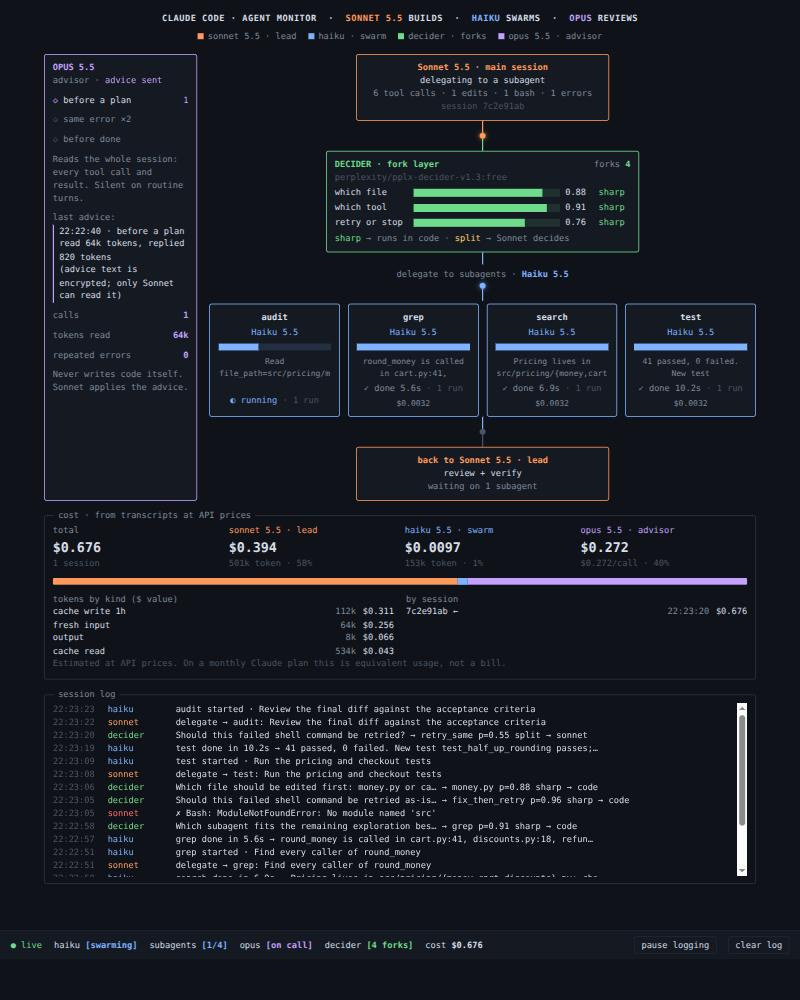

# claude-coding-factory

A global Claude Code setup that turns one session into a small "coding factory":

```
Sonnet 5.5 · lead ──► builds, edits, runs the plan
   │
   ├─► Decider (Perplexity) · fast forks, wired in by hooks
   │     • retry-or-stop after a failed command
   │     • which subagent after 5 searches in a row
   │
   ├─► Haiku 5.5 · swarm (subagents)
   │     search  maps the repo            (read-only, effort low)
   │     grep    finds call sites          (read-only, effort low)
   │     test    runs tests on your tree   (sees uncommitted changes)
   │     audit   reviews the diff          (throwaway worktree, effort high)
   │
   └─► Opus 5.5 · advisor
         called before a plan locks, on the same error twice, and to sign off
         on the audited diff (max 2 sign-off rounds)

done-gate (Stop hook): code changed but no test ran? The turn can't end until
Claude verifies, or says exactly why it can't.
```

Rules live in `~/.claude/CLAUDE.md` as **Factory principles**, adapted from
Lauren Tan's pstack (see Credits): acceptance criteria first, reproduce before
fixing, prove it works on the real artifact, label every claim measured / inferred /
guess, and turn a repeated correction into a check instead of more text.

An optional live monitor (`agent-monitor`, http://localhost:8790) shows the lead,
the Haiku swarm, Decider forks and Opus calls as they happen, with cost per role
computed from transcripts at API prices.



*Demo data from `docs/make_demo_events.py`, not a real session.*

## Requirements

- Claude Code 2.1.330 or newer (needs `advisorModel`, agent `effort` / `isolation`
  frontmatter and the `PostToolUseFailure` hook), Linux or macOS
- `python3` (3.9+, standard library only) and `git`
- Optional: an OpenRouter or Perplexity API key for Decider. Without one, the
  Decider hooks stay silent and everything else still works.

## Install

```bash
git clone https://github.com/<you>/claude-coding-factory
cd claude-coding-factory
python3 install.py --dry-run      # review every change as a diff
python3 install.py                # install; backs up what it touches
```

Then:

1. Put your key in `~/.claude/decider.env` (one line, after `OPENROUTER_API_KEY=`).
2. Start a **new** Claude Code session (CLAUDE.md is read at session start).
3. Optional: run `~/.claude/bin/agent-monitor` and open http://localhost:8790.

The installer:

- sets `model: claude-sonnet-5-5` and `advisorModel: claude-opus-5-5`
  (skip with `--keep-models`);
- **adds** its hooks next to any hooks you already have (never replaces them);
- writes the rules between `<!-- coding-factory:start -->` and `<!-- coding-factory:end -->`
  in `~/.claude/CLAUDE.md`, so re-running replaces only that block;
- copies agents, scripts, the monitor and the `research-playbook` skill;
- creates `decider.env` from the template once and never overwrites it.

It respects `CLAUDE_CONFIG_DIR` if you use a non-default config directory.

### Let Claude set it up

Open Claude Code in this folder and paste the prompt from
[SETUP_WITH_CLAUDE.md](SETUP_WITH_CLAUDE.md). Claude runs the dry run, shows you the
diff, and installs only after you say go.

## Uninstall

```bash
python3 uninstall.py --dry-run
python3 uninstall.py                  # keeps decider.env and model settings
python3 uninstall.py --reset-models --purge-key   # remove those too
```

## What gets installed

| Path | What it does |
|---|---|
| `agents/search.md`, `grep.md`, `test.md`, `audit.md` | Haiku 5.5 subagents |
| `bin/decide` | CLI for Perplexity Decider: `decide "question" "opt=meaning" ... <<< context` |
| `bin/decide-hook` | `PostToolUseFailure`: retry-or-stop note after a failed Bash command |
| `bin/delegate-hook` | `PreToolUse`/`UserPromptSubmit`: delegate note after 5 searches in a row |
| `bin/done-gate` | `Stop`: blocks once if code changed and no test ran after it |
| `bin/agent-monitor` | starts/stops the live monitor (`agent-monitor stop`) |
| `monitor/` | event hook, server, UI and price table for the monitor |
| `skills/research-playbook/` | research and experiment playbook (sources, labels, counterexamples) |
| `CLAUDE.md` block | delegation, advisor moments, factory principles, Decider rules |

## Privacy and cost notes

- Decider hooks send a short, redacted snippet (the failed command and its error, or
  recent search patterns) to OpenRouter or Perplexity. Turn Decider off for a
  sensitive project by leaving the key empty, or remove the two hooks.
- Free `:free` models on OpenRouter may have rate limits and their own data policy.
  Check your OpenRouter privacy settings.
- Each Opus advisor call re-reads the whole session at Opus prices. The rules limit
  it to three moments and two sign-off rounds.
- The monitor only records while it is running; costs shown are estimates at API
  prices, not a bill.

## Known limits

- "Which file" choices can't be routed to Decider: the model picks a file inside
  its own reasoning, before any hook runs. Only retry-or-stop and
  inline-vs-delegate are automated.
- `audit` needs a git repository (it runs in a worktree).
- `done-gate` accepts any test command; it can't tell whether the test was the
  relevant one.
- The advisor's advice text is encrypted, so the monitor shows when Opus was called
  and how many tokens it read, not what it said.

## Development

```bash
python3 -m pytest -q          # install/uninstall round trips in a throwaway HOME
```

The tests check the dry run, idempotent re-install, that your own hooks, agents,
permissions and CLAUDE.md rules survive, that `decider.env` is never overwritten, that
uninstall restores the original settings, and that every installed hook runs quietly.

## Credits

The Factory principles are an adaptation of ideas from **Lauren Tan (poteto)** as
presented in community write-ups and ports of her pstack toolkit, not her own text:
[pstack Claude Code port](https://github.com/ahmedbenaw/pstack),
[lauren-tan-ai-workflows](https://github.com/Latencius/lauren-tan-ai-workflows),
[talk: "All Code Is Slop (Except Mine)"](https://www.youtube.com/watch?v=O_zcc6Xl12g).
Decider models by Perplexity. Not affiliated with Anthropic, Perplexity or Lauren Tan.

---

## Tiếng Việt (tóm tắt)

Bộ cấu hình toàn cục cho Claude Code: Sonnet 5.5 làm chính, Haiku 5.5 chạy các
subagent tìm kiếm/test/review, Opus 5.5 làm advisor duyệt ở 3 thời điểm, Perplexity
Decider xử lý các ngã rẽ nhanh qua hook, và `done-gate` không cho báo "xong" khi chưa
chạy test. Cài: `python3 install.py --dry-run` để xem diff, rồi `python3 install.py`.
Dán API key vào `~/.claude/decider.env`, mở phiên Claude Code mới. Gỡ:
`python3 uninstall.py`.

## License

MIT
